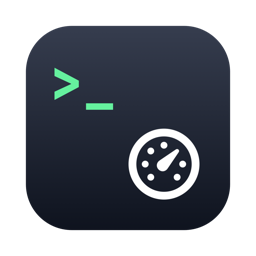
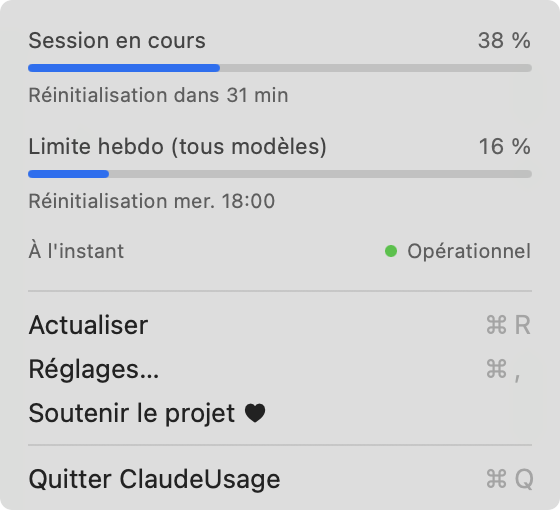

# ClaudeUsage : suivre sa consommation Claude Code dans la barre de menus du Mac

**Vos limites de session et de semaine Claude Code en un coup d'œil, sans demande de mot de passe et sans consommer de token.**

Une petite app gratuite et open source pour macOS, qui affiche où vous en êtes de vos limites d'usage Claude et quand elles se réinitialisent. Fonctionne avec un abonnement Claude.

[English](README.md) · [Site web](https://throover.github.io/ClaudeUsage/fr/)

> **Bêta.** Testée pour l'instant sur un seul abonnement Claude. Si quelque chose vous semble anormal, merci d'[ouvrir un ticket](../../issues).

<p></p>

## Pourquoi ClaudeUsage

- **Aucune demande de mot de passe :** l'app ne lit jamais votre trousseau ni votre jeton de connexion. Elle interroge Claude Code lui-même avec `/usage`.
- **Aucun token consommé :** dans nos tests, consulter votre consommation a utilisé 0 token, sans appel au modèle.
- **Limites de session et de semaine :** la fenêtre de 5 heures, la limite hebdomadaire et la date de réinitialisation de chacune.
- **Toujours à jour :** elle s'actualise toutes les 5 minutes, à l'ouverture du menu et à la demande.
- **Ligne facultative dans le terminal :** `Session 16% · Semaine 12%` sous la zone de saisie de Claude Code, avec vos rappels de raccourcis toujours visibles.
- **Native et légère :** un vrai menu macOS en Swift, avec des jauges discrètes  ou des pourcentages exacts dans la barre de menus, au choix.
- **Dans votre langue :** français, anglais, espagnol, italien, allemand, portugais, chinois et japonais, selon la langue de votre Mac.

## Installation

```sh
curl -fsSL https://raw.githubusercontent.com/Throover/ClaudeUsage/main/install.sh | sh
```

Ou téléchargez `ClaudeUsage.zip` depuis la [dernière version](../../releases/latest), décompressez-le et placez l'app dans **Applications**. L'app n'est pas notarisée par Apple, donc la première fois :

- **macOS 13–14 :** clic droit sur l'app → **Ouvrir** → **Ouvrir**.
- **macOS 15 et plus :** essayez de l'ouvrir une fois, puis allez dans **Réglages Système → Confidentialité et sécurité** et cliquez sur **Ouvrir quand même**.

## Prérequis

- macOS 13 Ventura ou plus récent. Testée sur Apple Silicon avec macOS 14. La version Intel a été testée via Rosetta, pas sur un Mac Intel.
- [Claude Code](https://claude.com/claude-code), connecté avec un abonnement Claude.

## Réglages

Choisissez **Réglages…** dans le menu :

| Réglage | Effet |
|---|---|
| Afficher l'usage de la session / de la semaine | Choisit ce qu'affiche la barre de menus |
| Affichage dans la barre de menus | Jauges rondes ou pourcentages |
| Afficher l'usage dans Claude Code | Ajoute la ligne sous la zone de saisie, pour les nouvelles sessions. Désactivé par défaut |
| Lancer au démarrage | Lance l'app au démarrage du Mac. Désactivé par défaut |

## Questions fréquentes

### Comment voir sa consommation Claude Code sur Mac ?

Installez ClaudeUsage : votre usage de session et de semaine reste visible dans la barre de menus. Cliquez sur les jauges pour les pourcentages exacts et les heures de réinitialisation.

### Pourquoi l'app ne demande-t-elle pas mon mot de passe ?

Les apps qui lisent votre jeton de connexion Claude dans le trousseau macOS peuvent déclencher des demandes de mot de passe. ClaudeUsage ne touche pas au trousseau : elle lance la commande `/usage` de Claude Code, qui gère seule la connexion.

### Consulter ma consommation entame-t-il mes limites ?

Dans nos tests, `/usage` a utilisé 0 token sans aucun coût : actualiser n'entame donc pas vos limites.

### L'app fonctionne-t-elle avec Claude Pro et Claude Max ?

Elle est faite pour les abonnements Claude. Elle a été testée pour l'instant sur Claude Pro ; les retours sur les autres abonnements sont les bienvenus.

### Que se passe-t-il si Claude Code change ?

L'app lit le texte affiché par `/usage`. Si une mise à jour change ce texte, le menu affiche **Échec de l'actualisation** jusqu'à la mise à jour de l'app.

### Quelles données quittent mon Mac ?

Vos données de consommation restent sur votre Mac, dans `~/.claude/claude-usage.json`. L'app contacte `status.claude.com` pour l'état du service et l'API GitHub pour détecter les nouvelles versions de Claude Code.

## Désinstallation

Désactivez d'abord **Afficher l'usage dans Claude Code** dans les réglages, puis :

```sh
pkill -x ClaudeUsage; rm -rf /Applications/ClaudeUsage.app ~/.claude/claude-usage.json "$HOME/Library/Application Support/ClaudeUsage"
```

## Compiler depuis les sources

Nécessite les Xcode Command Line Tools (`xcode-select --install`).

```sh
./build.sh --install
```

## Voir aussi

[TerminalPinch](https://github.com/Throover/TerminalPinch) : zoomer en pinçant dans le terminal du Mac.

## Soutenir

ClaudeUsage est gratuit. S'il vous est utile, vous pouvez le soutenir :

[](https://ko-fi.com/throover)
[](https://liberapay.com/Throover)

- **Ko-fi** : don ponctuel ou mensuel
- **Liberapay** : don récurrent, géré par une association à but non lucratif

## Licence

MIT. Projet indépendant, sans lien avec Anthropic ni approuvé par Anthropic.
