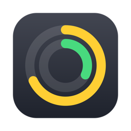
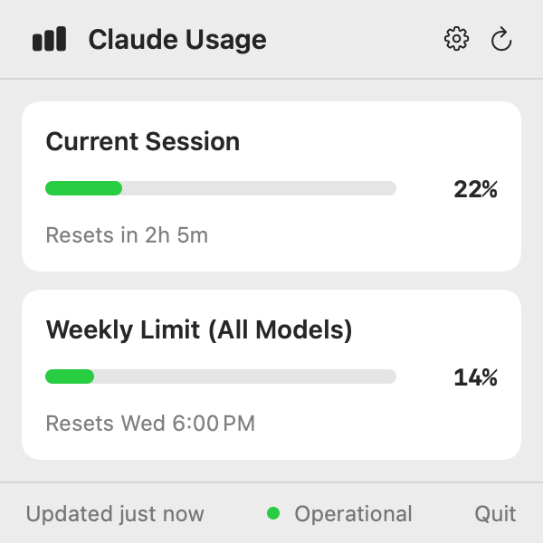

# ClaudeUsage

**Your Claude Code usage in the Mac menu bar, with no password prompts.**

A small free menu bar app for macOS. It shows how much of your session and weekly limits you have used, and when they reset.

[Français](README.fr.md)

> **Beta.** Tested on one Claude subscription so far. If something looks wrong, please [open an issue](../../issues).



- **No password prompts:** the app never reads your keychain or your sign-in token. It asks Claude Code itself, by running `/usage`.
- **No usage cost:** in our tests, reading your usage used 0 tokens.
- **Always current:** it refreshes every 5 minutes, when you open the panel, and when you click refresh.
- **In your language:** follows your Mac's language (English, French, Spanish, Italian, German, Portuguese, Chinese, Japanese).
- **Optional line in your terminal:** `Session 16% · Week 12%` under the Claude Code prompt, with your keyboard hints still visible. Turn it on in the app's settings.

## Install

```sh
curl -fsSL https://raw.githubusercontent.com/Throover/ClaudeUsage/main/install.sh | sh
```

Or download `ClaudeUsage.zip` from the [latest release](../../releases/latest), unzip it and move the app to **Applications**. The app isn't notarized by Apple, so the first time:

- **macOS 13–14:** right-click the app → **Open** → **Open**.
- **macOS 15+:** try to open it once, then go to **System Settings → Privacy & Security** and click **Open Anyway**.

## Requirements

- macOS 13 Ventura or later. Tested on Apple Silicon with macOS 14. The Intel version was tested through Rosetta, not on an Intel Mac.
- [Claude Code](https://claude.com/claude-code), signed in with a Claude subscription.

## Settings

Click the gear in the panel:

| Setting | Effect |
|---|---|
| Show session usage / Show weekly usage | Chooses the rings shown in the menu bar |
| Show usage in Claude Code | Adds the line under the prompt, for new sessions. Off by default |
| Launch at login | Starts the app with your Mac. Off by default |

## Good to know

- The app reads the text `/usage` displays. If a Claude Code update changes that text, the panel shows **Refresh failed** until the app is updated.
- The app contacts `status.claude.com` for the service status and the GitHub API to detect new Claude Code versions. Your usage data stays on your Mac, in `~/.claude/claude-usage.json`.

## Uninstall

Turn off **Show usage in Claude Code** in the settings first, then:

```sh
pkill -x ClaudeUsage; rm -rf /Applications/ClaudeUsage.app ~/.claude/claude-usage.json "$HOME/Library/Application Support/ClaudeUsage"
```

## Build from source

Requires the Xcode Command Line Tools.

```sh
./build.sh --install
```

## Support

ClaudeUsage is free. If it's useful to you, you can support it:

[](https://ko-fi.com/throover)
[](https://liberapay.com/Throover)

- **Ko-fi** — one-time or monthly
- **Liberapay** — recurring, run by a non-profit

## License

MIT. This is an independent project, not affiliated with or endorsed by Anthropic.
