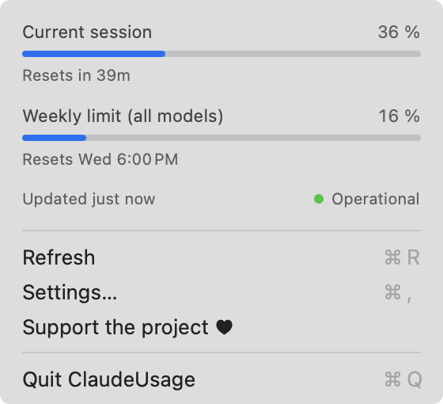

# ClaudeUsage: Claude Code usage monitor for your Mac menu bar

**See your Claude Code session and weekly limits at a glance, with no password prompts and no tokens used.**

A small, free and open source macOS menu bar app that shows how much of your Claude usage limits you have used and when they reset. Works with a Claude subscription.

[Français](README.fr.md) · [Website](https://throover.github.io/ClaudeUsage/)

> **Beta.** Tested on one Claude subscription so far. If something looks wrong, please [open an issue](../../issues).

<p></p>

## Why ClaudeUsage

- **No password or keychain prompts:** the app never reads your keychain or your sign-in token. It asks Claude Code itself, by running `/usage`.
- **No tokens used:** in our tests, checking your usage used 0 tokens and made no model call.
- **Session and weekly limits:** the 5-hour session window, the weekly limit and when each one resets.
- **Always current:** it refreshes every 5 minutes, when you open the menu, and on demand.
- **Optional line in your terminal:** `Session 16% · Week 12%` under the Claude Code prompt, with your keyboard hints still visible.
- **Native and light:** a real macOS menu in Swift, with discreet  gauges or exact percentages in the menu bar, as you prefer.
- **In your language:** English, French, Spanish, Italian, German, Portuguese, Chinese and Japanese, following your Mac.

## Install

```sh
curl -fsSL https://raw.githubusercontent.com/Throover/ClaudeUsage/main/install.sh | sh
```

Or download `ClaudeUsage.zip` from the [latest release](../../releases/latest), unzip it and move the app to **Applications**. The app isn't notarized by Apple, so the first time:

- **macOS 13–14:** right-click the app → **Open** → **Open**.
- **macOS 15+:** try to open it once, then go to **System Settings → Privacy & Security** and click **Open Anyway**.

## Requirements

- macOS 13 Ventura or later. Tested on Apple Silicon with macOS 14. The Intel version was tested through Rosetta, not on an Intel Mac.
- [Claude Code](https://claude.com/claude-code), signed in with a Claude subscription.

## Settings

Choose **Settings…** in the menu:

| Setting | Effect |
|---|---|
| Show session usage / Show weekly usage | Chooses what the menu bar shows |
| Menu bar display | Round gauges or percentages |
| Show usage in Claude Code | Adds the line under the prompt, for new sessions. Off by default |
| Launch at login | Starts the app with your Mac. Off by default |

## FAQ

### How do I check my Claude Code usage on a Mac?

Install ClaudeUsage: your session and weekly usage stay visible in the menu bar. Click the gauges for the exact percentages and reset times.

### Why doesn't it ask for my password?

Apps that read your Claude sign-in token from the macOS keychain can trigger password prompts. ClaudeUsage doesn't touch the keychain: it runs Claude Code's own `/usage` command, which handles sign-in by itself.

### Does checking my usage count against my limits?

In our tests, `/usage` used 0 tokens and cost nothing, so refreshing doesn't consume your limits.

### Does it work with Claude Pro and Claude Max?

It's made for Claude subscriptions. So far it has been tested on Claude Pro; reports from other plans are welcome.

### What happens if Claude Code changes?

The app reads the text `/usage` displays. If an update changes that text, the menu shows **Refresh failed** until the app is updated.

### What data leaves my Mac?

Your usage data stays on your Mac, in `~/.claude/claude-usage.json`. The app contacts `status.claude.com` for the service status and the GitHub API to detect new Claude Code versions.

## Uninstall

Turn off **Show usage in Claude Code** in the settings first, then:

```sh
pkill -x ClaudeUsage; rm -rf /Applications/ClaudeUsage.app ~/.claude/claude-usage.json "$HOME/Library/Application Support/ClaudeUsage"
```

## Build from source

Requires the Xcode Command Line Tools (`xcode-select --install`).

```sh
./build.sh --install
```

## See also

[TerminalPinch](https://github.com/Throover/TerminalPinch): pinch to zoom in your Mac terminal.

## Support

ClaudeUsage is free. If it's useful to you, you can support it:

[](https://ko-fi.com/throover)
[](https://liberapay.com/Throover)

- **Ko-fi** — one-time or monthly
- **Liberapay** — recurring, run by a non-profit

## License

MIT. This is an independent project, not affiliated with or endorsed by Anthropic.
